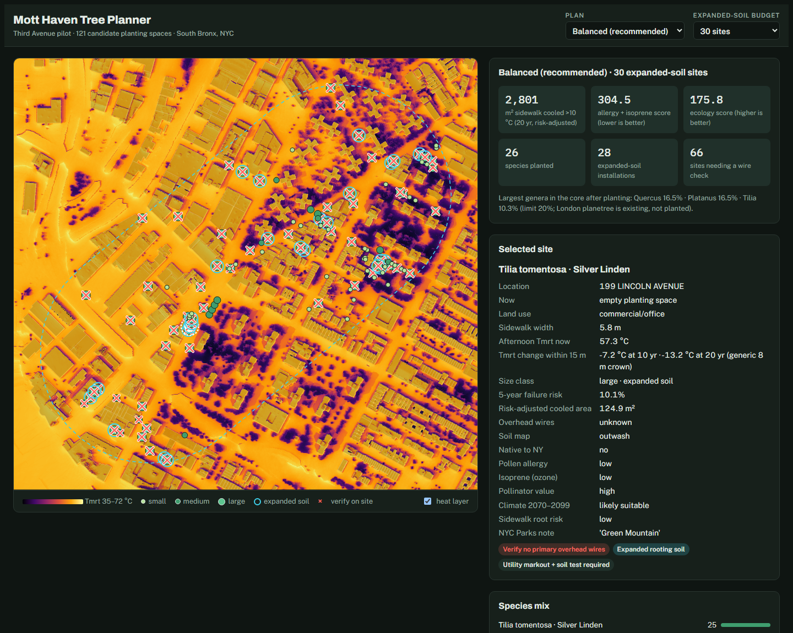
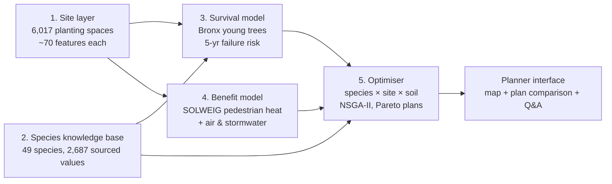
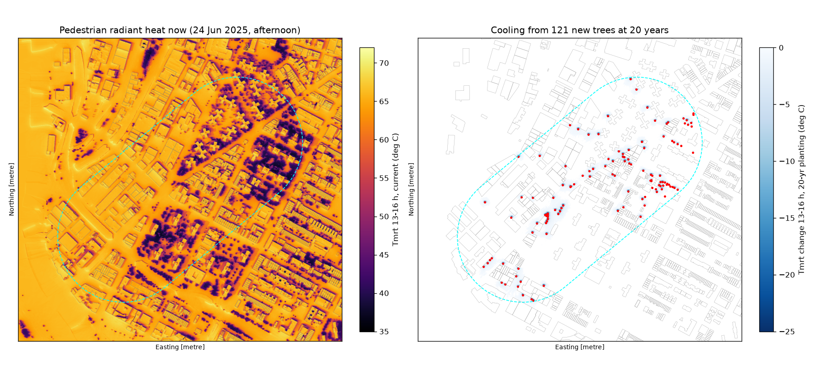
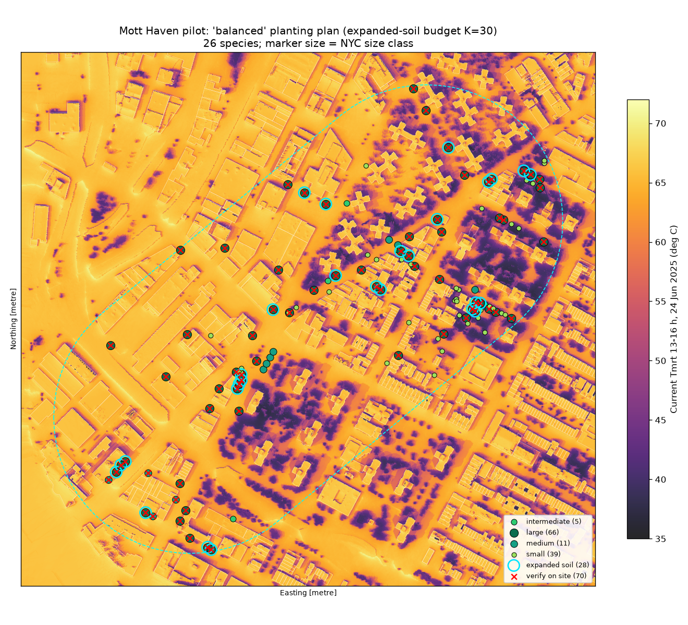

# Urban Forestry GeoAI: Mott Haven Pilot

**Which tree should be planted where, to cool streets and stay healthy?**

This project is a working prototype of a specialised GeoAI tool for urban planners. For one small trial area (Third Avenue, Mott Haven, South Bronx, New York City), it combines satellite data, aerial LiDAR, city tree records and published species science. From these it recommends **a species and a soil treatment for each of 121 real planting spaces**, and shows the trade-off between cooling, tree survival, allergy/ozone risk and ecology.



> **Status:** research prototype (Nov 2026). The results are model outputs, not planting approvals. Every site still needs a field check (utilities, soil, overhead wires) before planting.

---

## What it does, in five steps



| Step | What it does | Main data |
|---|---|---|
| **1. Site layer** | Describes every planting space: sidewalk width, shade hours, nearby canopy, paving, surface heat, land use, soil, heat vulnerability, tree history | NYC Open Data, USGS LiDAR 2017, NAIP, Landsat 8/9, ECOSTRESS, Sentinel-2, PLUTO, SSURGO |
| **2. Species knowledge base** | 41 NYC-approved species plus 8 common local trees, every value with a source: tolerances, native status, pollen allergy, isoprene (ozone), pollinator value, climate 2070–2099, root damage, soil volume | NYC Parks, USDA PLANTS, NY Flora Atlas, USFS/NIACS, Xerces, UF fact sheets, peer-reviewed papers |
| **3. Survival model** | Predicts the chance that a young tree fails within 5 years at a given site (LightGBM, spatial cross-validation) | 20,309 young Bronx trees from NYC Forestry records |
| **4. Benefit model** | Simulates afternoon pedestrian radiant heat (Tmrt) on the hottest clear day of 2019–2025 (24 Jun 2025), with and without new trees, at 1 m | SOLWEIG (UMEP), LiDAR, ERA5 adjusted to observed temperatures |
| **5. Optimiser** | Chooses species and expanded soil for each site under NYC rules (diversity 10-20-30, overhead wires, narrow sidewalks, location notes) | All of the above |

---

## Key results

### The site layer

*Left: planting spaces over afternoon surface heat (ECOSTRESS). Right: building-only sun hours from the LiDAR shadow simulation.*

- **121 candidate spaces** in the 0.48 km² core: 88 empty, 29 removed trees or stumps, 4 dead trees.
- **London planetree is 19.9% of existing core trees**, above the 10% single-species guideline, so it is not planted again.
- Afternoon surface heat rises with paving (r = +0.39) and falls with nearby canopy (r = −0.28).

### Survival model (young-tree failure, Bronx)
| Model (spatial CV, 132 one-km blocks) | AUC | AUC at equal exposure |
|---|---|---|
| Record age only | 0.715 | 0.536 |
| + species & traits | 0.736 | 0.553 |
| **+ site conditions** | **0.779** | **0.652** |

**Site conditions matter more than species.** Paved surroundings, curbside pits and the highest heat-vulnerability ZIP codes raise failure risk. Probabilities are calibrated (e.g. predicted 28.5% → observed 28.5%).

### Cooling benefit (SOLWEIG)


- **Sanity check:** existing tree shade lowers afternoon radiant heat on sidewalks from **60 °C to 45 °C**.
- **Locally:** a new tree cools nearby sidewalk by **−2.5 °C after 10 years and −4.8 °C after 20 years** (median). The best sites reach **−13 °C**.
- **Corridor-wide:** 121 trees shift the average by only about 1 °C, so cooling the whole street needs more planting sites and larger crowns.

### Optimised planting plan


| Plan (30 expanded-soil sites) | Cooling m² | Allergy + ozone risk ↓ | Ecology ↑ |
|---|---|---|---|
| Optimiser: max cooling | **3,012** | 330 | 134 |
| **Optimiser: balanced (recommended)** | 2,801 | **305** | **176** |
| Rule: biggest tree that fits | 2,943 | 429 | 90 |
| Rule: NYC's commonly planted mix | 2,955 | 426 | 87 |

**The balanced plan keeps ~95% of the cooling while cutting allergy/ozone risk by ~29% and doubling ecological value.**

---

## Try the interface

The planner interface is a single web page in [`interface/`](interface/): map, plan switcher, site details, plan comparison.

```bash
python -m http.server 8765 --directory interface
```
Then open <http://localhost:8765>. Add `#site-19` to the address to open a specific site.
The **"Ask about this plan"** box (Claude Q&A) only works when the page is opened inside Claude. Everything else works in any browser.

| Desktop | Phone |
|---|---|
|  |  |

See **[DEMO.md](DEMO.md)** for a 5-minute walkthrough to show someone the trial.

---

## Project structure

```
docs/            Plans and write-ups for each module (start with Pilot_Plan_v2.md)
  images/        Figures and interface screenshots used in this README
scripts/         All analysis code, numbered by pipeline order below
interface/       Planner web page (index.html, data.json, tmrt.png)
data/aoi/        Pilot area boundaries (GeoJSON)
data/species/    Species knowledge base, evidence table, sources, research-agent evidence
data/processed/  Site table, survival risk, benefits, optimiser plans, Bronx composites
data/raw/        Small raw tables (audit summaries, weather, soils, HVI, NYCCAS)
models/          Trained survival model + calibration
outputs/         Metrics (JSON) and maps (PNG)
```

### Documentation
| Topic | File |
|---|---|
| Feasibility and pilot plan | [docs/Pilot_Plan_v2.md](docs/Pilot_Plan_v2.md) |
| Data audit (what exists, gaps) | [docs/Data_Audit_Area_A.md](docs/Data_Audit_Area_A.md) |
| Site features | [docs/Site_Features.md](docs/Site_Features.md) |
| Species knowledge base | [docs/Species_KB.md](docs/Species_KB.md) |
| Survival model | [docs/Survival_Model.md](docs/Survival_Model.md) |
| Benefit modelling | [docs/Benefits_Model.md](docs/Benefits_Model.md) |
| Optimiser | [docs/Optimiser.md](docs/Optimiser.md) |

---

## Reproduce

Large raw files (LiDAR, imagery, SOLWEIG rasters, ~950 MB) are **not** in the repository; the scripts download or rebuild them.

```bash
pip install -r requirements.txt
```

Run in this order:

| # | Script | Produces |
|---|---|---|
| 1 | `make_aoi.py` | Pilot boundaries |
| 2 | `audit_nyc_opendata.py`, `audit_satellite.py`, `audit_ground.py` | City layers + data audit |
| 3 | `download_optical_thermal.py`, `download_naip.py`, `download_lidar.py`, `refine_lidar.py` | Imagery, LST, LiDAR surfaces & canopy |
| 4 | `download_ecostress.py` | ECOSTRESS LST (needs a NASA Earthdata token in `~/.earthdata_token`) |
| 5 | `shade_hours.py`, `composites.py`, `build_sites.py` | Site layer |
| 6 | `species_local_performance.py`, `species_usda_plants.py`, `build_species_kb.py` | Species knowledge base |
| 7 | `download_bronx_training.py`, `bronx_composites.py`, `train_survival.py` | Survival model |
| 8 | `solweig_scenarios.py`, `benefits.py` | Heat, air and stormwater benefits |
| 9 | `optimise_planting.py 30 400`, `plot_plan.py balanced 30` | Planting plans (args: soil budget K, generations) |
| 10 | `export_interface.py` | Interface data |

---

## Limits (read before using results)

- **Tmrt is pedestrian radiant heat**, not air temperature. It comes from one hot day with a generic tree crown. The SOLWEIG package used is an experimental UMEP port.
- **Crown sizes at 10 and 20 years are assumptions**, pending the USFS Urban Tree Database growth curves.
- **Failure risk is a proxy** from city inventory records, not measured survival. Real survival needs the Trees Count 2025 census.
- **Overhead wires are known at only 11 of 121 sites.** Pit soil and underground utilities are not public.
- **Air quality and stormwater figures** are first-order per-canopy estimates (Nowak et al. 2018). Dense crowns in narrow streets can trap pollution, and oaks emit ozone-forming isoprene.
- **No field validation yet.** A summer field campaign with globe thermometers and soil sampling is the next step.

## Data sources and credits

NYC Open Data (NYC Parks Forestry, DOITT, DCP PLUTO, DEP, DOHMH) · USGS 3DEP LiDAR (NY_NewYorkCity) · USDA NAIP · NASA/USGS Landsat 8/9 · ESA Sentinel-2 (Copernicus) · NASA ECOSTRESS · ERA5 reanalysis via Open-Meteo (CC BY 4.0) · NOAA ACIS station data · Microsoft Planetary Computer · USDA NRCS SSURGO & PLANTS · NYS Mesonet · New York Flora Atlas · USFS Climate Change Tree Atlas & NIACS · Xerces Society · UF/USFS street-tree fact sheets · APHIS · Nowak et al. (2018) *The urban forest of New York City* · SOLWEIG/UMEP (Lindberg et al. 2008; Lindberg et al. 2018). Full citations are in `data/species/sources.csv` and the docs.

**Author:** Bipul Roy. Analysis built with Claude (Anthropic).
