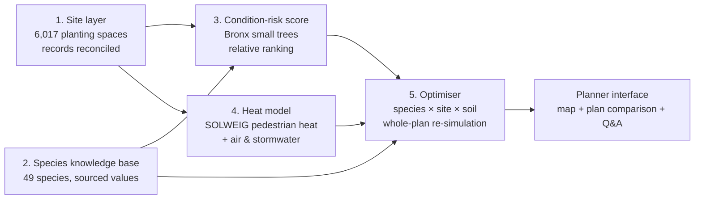
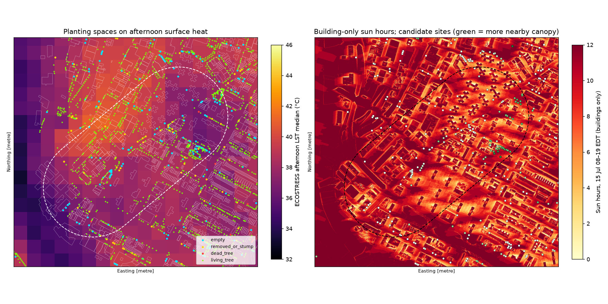
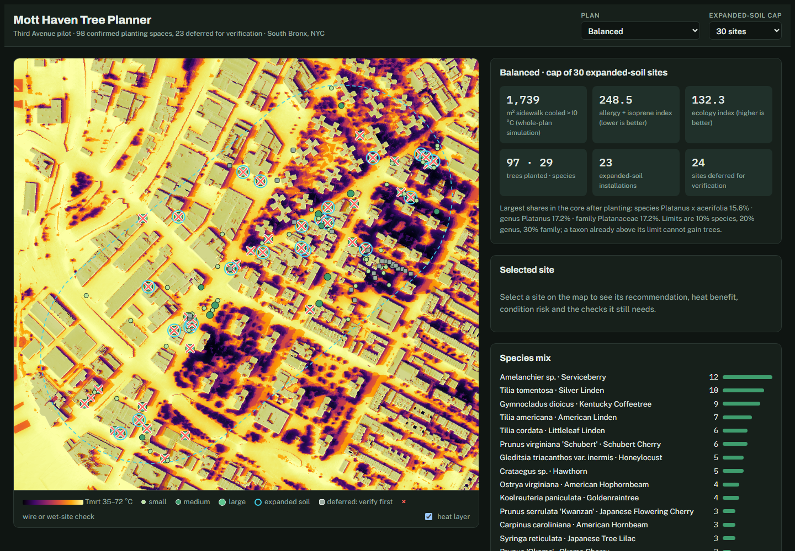
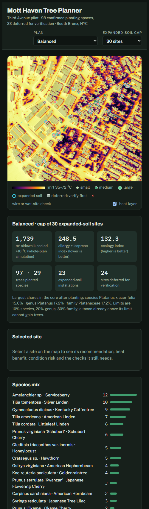

# Urban Forestry GeoAI: Mott Haven Pilot

**Which tree should be planted where, to cool streets, and what still has to be checked first?**

This project is a research prototype of a GeoAI planning tool. For one small trial area (Third Avenue, Mott Haven, South Bronx, New York City), it combines satellite data, aerial LiDAR, city tree records and published species science. It recommends **a species and a soil treatment for 97 planting spaces**, defers 24 spaces whose records need checking, and shows the trade-off between cooling, allergy/ozone risk and ecology.


> **Status (16 Nov 2026):** remote screening and simulation study. The results were **revised after an external audit**; see [What changed](#what-changed-in-the-november-2026-revision). They are model outputs, not planting approvals, and nothing has been validated in the field.

---

## What it does, in five steps



| Step | What it does | Main data |
|---|---|---|
| **1. Site layer** | Describes every planting space and reconciles its status with the tree record. Conflicting records are sent to review | NYC Open Data, USGS LiDAR 2017, NAIP, Landsat 8/9, ECOSTRESS, Sentinel-2, PLUTO, SSURGO |
| **2. Species knowledge base** | 41 NYC-approved species plus 8 common local trees, every value with a source; conflicts between sources are kept visible | NYC Parks, USDA PLANTS, NY Flora Atlas, USFS/NIACS, Xerces, UF fact sheets, peer-reviewed papers |
| **3. Condition-risk score** | Ranks sites by the recorded condition of small trees in similar places. A relative score, **not** a survival probability | 20,309 small Bronx trees from NYC Forestry records |
| **4. Heat model** | Simulates afternoon pedestrian radiant heat (Tmrt) at 1 m on the hottest clear day of 2019–2025, with and without new trees | SOLWEIG (UMEP), LiDAR, ERA5 adjusted to observed temperatures |
| **5. Optimiser** | Chooses species and expanded soil under NYC rules, then re-simulates each shortlisted plan as a whole | All of the above |

---

## Key results

### Sites

*Left: planting spaces over afternoon surface heat (ECOSTRESS). Right: building-only sun hours from the LiDAR shadow simulation. Figure from the first build; site classes have since been reconciled.*

- The 0.48 km² core has 594 planting spaces: **98 confirmed candidates**, **23 with conflicting records** (deferred), and 473 living trees to retain.
- **London planetree is 19.9% of existing core trees**, above the 10% single-species guideline, so it is not planted again.
- No candidate has a recorded pit width or length, and wire status is known at only 9 sites.

### Condition-risk score (Bronx small trees)
| Model (spatial CV, 132 one-km blocks) | AUC | AUC within record-year cohorts |
|---|---|---|
| Record age only | 0.715 | 0.536 |
| + species & traits | 0.736 | 0.553 |
| **+ site conditions** | **0.779** | **0.648** |

- **Site conditions rank trees better than species does.** Paved surroundings and curbside pits go with poorer recorded condition.
- **The score is for ranking only.** Its probabilities do not transfer between neighbourhoods: a nested calibration test made the error worse (Brier 0.129 vs 0.117 raw). The sample is also biased, because trees that outgrow the 4-inch cut-off drop out.

### Cooling (SOLWEIG, 24 June 2025, 13:00–17:00)


- **Plausibility check:** sidewalk under existing canopy averages **45 °C** Tmrt against **62 °C** in the open (model compared with itself).
- **Locally:** the sidewalk nearest a new tree cools by a median **−2.6 °C with a 5 m crown** and **−4.8 °C with an 8 m crown**.
- **Corridor-wide:** 98 trees with 8 m crowns cool **2,167 m²** of sidewalk by more than 10 °C, each square metre counted once. The core average moves only from **58.7 to 57.9 °C**.

### Planting plans (30 expanded-soil sites, whole-plan simulation)


| Plan | Cooled sidewalk m² | Allergy + isoprene index ↓ | Ecology index ↑ |
|---|---|---|---|
| Optimiser: max cooling | **2,004** | 348 | 76 |
| **Optimiser: balanced** | 1,739 | **249** | **132** |
| Rule: biggest tree that fits | **2,004** | 351 | 67 |
| Rule: NYC's commonly planted mix | 1,989 | 342 | 72 |
| Random approved species | 1,588 | 299 | 95 |

- **On cooling alone, the optimiser only ties the simple rule** "plant the biggest tree that fits".
- **Its value is the trade-off:** the balanced plan keeps 87% of the maximum cooling, with a 29% lower allergy/isoprene index and about double the ecology index. These are constructed indices, not measured health or biodiversity outcomes.

---

## What changed in the November 2026 revision

An external audit and a code review found errors in the first version. All were fixed and every number above was recomputed.

| Problem | Fix |
|---|---|
| Weather and sun position were one hour apart (UTC−5 vs UTC−4) | One clock; a check asserts radiation peaks at solar noon |
| Cooling was double-counted where tree buffers overlap (3,783 m² reported vs 2,277 m² unique) | Each sidewalk pixel is counted once; an assertion guards it |
| Sentinel-2 files mixed two processing versions and contained duplicates | Offset corrected; one image per acquisition (105 → 95) |
| "5-year failure probability" overstated the model | Renamed recorded-condition risk; raw relative score; biased sample documented |
| Calibration was tested on its own training data | Nested test; calibration dropped because it made results worse |
| 23 sites with conflicting records were treated as plantable | Reconciled; deferred for verification |
| No ground-material map in the heat model | Paved, grass, water and roofs; sidewalks always paved |
| "10-year / 20-year" labels without a growth model | Scenarios named by assumed crown size |
| Diversity rule lacked the family limit | Species 10%, genus 20%, family 30% |

---

## Try the interface

The planner interface is a single web page in [`interface/`](interface/).

```bash
python -m http.server 8765 --directory interface
```
Then open <http://localhost:8765>. Add `#site-5` to the address to open a specific site.
The **"Ask about this plan"** box (Claude Q&A) only works when the page is opened inside Claude. Everything else works in any browser.

| Desktop | Phone |
|---|---|
|  |  |

See **[DEMO.md](DEMO.md)** for a short walkthrough.

---

## Project structure

```
docs/            Write-ups for each module (start with Pilot_Plan_v2.md)
  images/        Figures and interface screenshots used in this README
scripts/         All analysis code, in the pipeline order below
interface/       Planner web page (index.html, data.json, tmrt.png)
data/aoi/        Pilot area boundaries (GeoJSON)
data/species/    Species knowledge base, evidence table, sources
data/processed/  Site table, condition risk, benefits, optimiser plans, Bronx composites
data/raw/        Small raw tables (audit summaries, weather, soils, HVI, NYCCAS)
models/          Trained condition-risk model
outputs/         Metrics (JSON/CSV) and maps (PNG)
```

### Documentation
| Topic | File |
|---|---|
| Feasibility and pilot plan (original) | [docs/Pilot_Plan_v2.md](docs/Pilot_Plan_v2.md) |
| Data audit | [docs/Data_Audit_Area_A.md](docs/Data_Audit_Area_A.md) |
| Site features | [docs/Site_Features.md](docs/Site_Features.md) |
| Species knowledge base | [docs/Species_KB.md](docs/Species_KB.md) |
| Condition-risk model | [docs/Condition_Risk_Model.md](docs/Condition_Risk_Model.md) |
| Benefit modelling | [docs/Benefits_Model.md](docs/Benefits_Model.md) |
| Optimiser | [docs/Optimiser.md](docs/Optimiser.md) |

---

## Reproduce

Large raw files (LiDAR, imagery, heat rasters, ~1 GB) are **not** in the repository; the scripts download or rebuild them.

```bash
pip install -r requirements.txt
```

| # | Script | Produces |
|---|---|---|
| 1 | `make_aoi.py` | Pilot boundaries |
| 2 | `audit_nyc_opendata.py`, `audit_satellite.py`, `audit_ground.py` | City layers + data audit |
| 3 | `download_optical_thermal.py`, `download_naip.py`, `download_lidar.py`, `refine_lidar.py` | Imagery, LST, LiDAR surfaces and canopy |
| 4 | `download_ecostress.py` | ECOSTRESS LST (needs a NASA Earthdata token in `~/.earthdata_token`) |
| 5 | `shade_hours.py`, `composites.py`, `build_sites.py` | Site layer |
| 6 | `species_local_performance.py`, `species_usda_plants.py`, `build_species_kb.py` | Species knowledge base |
| 7 | `download_bronx_training.py`, `bronx_composites.py`, `train_condition_risk.py` | Condition-risk model |
| 8 | `solweig_scenarios.py`, `benefits.py` | Heat scenarios and per-site benefits |
| 9 | `optimise_planting.py 30 400` (also 0 and 60) | Planting plans |
| 10 | `solweig_scenarios.py --plans balanced_K30 ...`, `evaluate_plans.py` | Whole-plan simulation |
| 11 | `plot_plan.py balanced 30`, `export_interface.py` | Plan map and interface data |

---

## Limits (read before using results)

- **Simulated, not measured.** Tmrt is pedestrian radiant heat on one hot day from an experimental SOLWEIG port. It is not air temperature.
- **Crown sizes are assumptions.** There is no growth model yet.
- **Condition risk is a relative score** from city inventory records, not survival.
- **Feasibility is unconfirmed.** Pit sizes, most wire and ownership records, and underground utilities are unknown.
- **Indices are constructed.** Allergy/isoprene and ecology values summarise published categories; sources often disagree.
- **Air-quality and stormwater figures** are first-order removal estimates, not changes in the air people breathe.
- **Known open items:** ECOSTRESS quality filtering, species growth curves, a planting-date-based survival model, field validation.

## Data sources and credits

NYC Open Data (NYC Parks Forestry, DOITT, DCP PLUTO, DEP, DOHMH) · USGS 3DEP LiDAR (NY_NewYorkCity) · USDA NAIP · NASA/USGS Landsat 8/9 · ESA Sentinel-2 (Copernicus) · NASA ECOSTRESS · ERA5 reanalysis via Open-Meteo (CC BY 4.0) · NOAA ACIS station data · Microsoft Planetary Computer · USDA NRCS SSURGO & PLANTS · New York Flora Atlas · USFS Climate Change Tree Atlas & NIACS · Xerces Society · UF/USFS street-tree fact sheets · APHIS · Nowak et al. (2018) *The urban forest of New York City* · SOLWEIG/UMEP (Lindberg et al. 2008; Lindberg et al. 2018). Full citations are in `data/species/sources.csv` and the docs.

**Author:** Bipul Roy. Analysis built with Claude (Anthropic).
